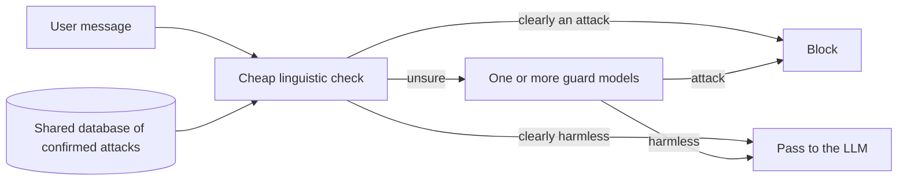

# Adversarial input detection as a shared internet service

AAU MSc Software, 7th semester project (Software 7, Group 5), Aalborg University Copenhagen, 2026.

Large language models (LLMs) can be tricked by adversarial user input: jailbreaks that get around the safety rules, and prompt injections that override the instructions of an app. Guard models can catch these attacks, but checking every message with a guard model costs compute and makes every answer slower. Cheaper detectors are fast, but they can miss attacks that use persuasion, role play or paraphrasing.

We are building a shared detection service that runs a cheap linguistic check before the guard models, so that only the inputs the check is unsure about reach a guard model.

## How the service works

The cheap check uses linguistic rules based on known attack techniques, and compares the input with a shared database of attacks that were already confirmed. Because the service is shared, an attack caught for one app can help catch similar attacks in other apps.

## Research question

> Can a shared service that runs a cheap linguistic check before the guard models reduce guard-model calls, processing cost and response time, while detecting as many direct jailbreaks and prompt injections as a guard model alone?

1. Which linguistic features of attacker tricks let the cheap check decide most inputs by itself?
2. How many guard-model calls, how much cost and how much response time does the check save, and how many attacks does it miss?
3. How many guard models (1 to X) should check the remaining inputs?

We focus on jailbreaks and prompt injections that users send directly, in English text. Indirect prompt injection (for example through web pages or emails) and other languages are outside our scope.

## What's in this repository

| Folder | What it is | Status |
|---|---|---|
| [`classifier-testing/`](classifier-testing/) | A notebook that tests six existing classifiers on public datasets of jailbreaks and prompt injections: our rule-based check, a TF-IDF model, ProtectAI DeBERTa v2, Prompt Guard 2, Qwen3Guard and Llama Guard 3. | First results done |

The code for the service itself (the cheap check, the guard-model step and the shared database) comes next.

## Results so far

- Jailbreaks are much easier to catch than the prompt injections in the deepset dataset. Prompt Guard 2 catches 93.5% of the jailbreaks with one false alarm in 123 harmless prompts, but on the deepset injections none of the six classifiers catch more than 37%.
- On the HackAPrompt injections the two models made for injections catch 88.5% and 99.5%, so the problem is the kind of injections in deepset, not prompt injections in general.
- The guard LLMs judge harm and not tricks, so they let harmless-looking attacks through. Our cheap checks only know the words they were built or trained on.
- The guard LLMs take about 0.4 to 0.6 seconds per prompt on a T4 GPU, the cheap checks a few milliseconds or less.

All numbers and how we got them are in [`classifier-testing/`](classifier-testing/).

## Getting started

You need Python 3.10 or newer and, for the Meta models and the HackAPrompt dataset, a Hugging Face account with access to them. The setup for Google Colab and for your own computer is in [`classifier-testing/README.md`](classifier-testing/README.md) and at the top of the notebook.

## Team

Awantika Chaudhary, Konstantina Diamanti, Orsolya Szántó, Tomás Melo, Rupesh Parajuli and Samarpan Kafle.

Supervisors: Dorielle Lonke and Josephine Bakka.
